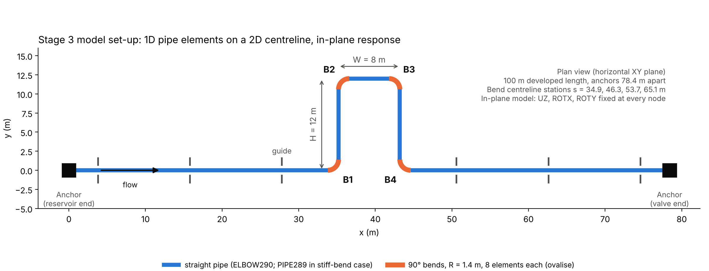

# Stage 3 – Expansion-loop in-plane modes

**Question (brief):** how do geometry and supports affect vibration? The task is to show the first six in-plane frequencies and mode shapes, vary the loop dimensions and guide restraints, and justify all restraints and the fluid mass.

## What we did

- **Model type:** **1D pipe elements on the centreline, not shells.**
  - **ANSYS:** ELBOW290 along the whole line. Its cross-section can ovalise, which captures bend flexibility, and the straight pipe either side naturally restrains that ovalisation.
  - **Comparison case:** PIPE289 with stiff bends.
  - **Independent check:** a Python 2D frame model using the ASME B31.3 flexibility factor.
- **LNG:** included as **distributed mass** (417.7 kg/m in total, moving with the pipe), not as a load. A modal analysis has no applied loads, so gravity, internal pressure and thermal loads are left for Stage 4.
- **Supports:**
  - anchors (all DOF fixed) at the reservoir and valve ends;
  - frictionless sliding guides (lateral movement fixed), with the first guide 6 m from each loop leg and then every 12 m;
  - vertical support assumed throughout, so the model is in-plane only.
- **Cases:** loop height 8, 12 and 16 m; width 4, 8 and 12 m; first guide at 3, 6 and 12 m, plus a no-guides case; stiff bends; mesh checks; ovalisation-term convergence (v5).
- **Outputs:** first six in-plane frequencies and mode shapes, plus bend geometry and mode shapes at the bends for Stage 4. Run `python_check/stage3_analysis.py` to rebuild the checks and figures.

### Model dimensionality (1D / 2D / 3D)

- **The elements are 1D.** Each element is a line along the pipe centreline. The pipe's cross-section (OD 0.813 m, 9.53 mm wall) is a *section property*, not meshed geometry, so there is no shell or solid mesh.
- **The geometry is 2D.** The centreline lies flat in the horizontal XY plane (plan view of the loop).
- **The element formulation is 3D.** PIPE289 and ELBOW290 are 3D elements with 6 DOF per node (UX, UY, UZ, ROTX, ROTY, ROTZ). ELBOW290 adds extra *section* DOFs that let the cross-section ovalise, which is what makes the bends flexible.
- **The response is restricted to 2D in-plane.** UZ, ROTX and ROTY are fixed at every centreline node, so each node only moves in x and y and rotates about z. In effect this is a **2D frame model built from 3D pipe elements**. The Python check (`python_check/stage3_loop_beam_check.py`) is the same idea written directly as a 2D frame.
- **Viewing the model:** after a run, read `ansys/stage3_view_v1.inp` in the MAPDL GUI. It produces:
  - the line rendered as a 3D tube, with the supports;
  - 3D mode shapes;
  - a close-up of bend B2 ovalising;
  - an on-screen animation of mode 2.

## Contents

| Path | What it is |
|---|---|
| `ansys/stage3_loop_modal.inp` | Mechanical APDL script. It runs 14 cases and writes `stage3_results.csv`, then exports the baseline bend geometry and mode shapes for Stage 4 as CSVs and saves the mode-shape PNGs. |
| `python_check/stage3_analysis.py` | Post-processes an ANSYS run: convergence, comparison with the Python model, bend-force checks and figures. It writes `results/<run>/stage3_checks.md` and `figures/<run>/`. |
| `python_check/stage3_loop_beam_check.py` | An independent 2D frame FE model of the same loop. It uses the ASME B31.3 bend flexibility factor (k ≈ 20) and writes `results/stage3_beam_check.csv`. |

## How to run

1. **ANSYS:** open Mechanical APDL 2023 R1 and point it at an empty folder with *File → Change Directory*. Then load the script with *File → Read Input from… → `stage3_loop_modal.inp`*. Copy the two CSVs and the PNGs into `results/` and `figures/`.
   - **Workbench alternative:** add a *Mechanical APDL* component system, right-click *Analysis → Add Input File*, pick the script, then click *Update*.
2. **Python:**
   - `python python_check/stage3_loop_beam_check.py` runs the independent frame model.
   - `python python_check/stage3_analysis.py v5` runs the checks and figures for the v5 run (use `v4_2fourier` for the old run).
   - Both need numpy, scipy, pandas and matplotlib.

## ANSYS runs

| Run | Folder | Notes |
|---|---|---|
| v4 | `results/v4_2fourier/`, `figures/v4_2fourier/` | Complete. Mesh converged (≤ 0.6 %), but bend ovalisation **not** converged at the default 2 Fourier terms: mode 1 drops 27 % at 4 terms. Kept as evidence for the convergence study. |
| **v5 (final)** | `results/v5/`, `figures/v5/` | All cases at 8 Fourier terms (the ELBOW290 maximum), with 32 section cells and a 2–8 term sweep (cases 13–18). Ovalisation is converged (7 → 8 terms: 0.02 %) and the mesh is converged (≤ 0.5 %). Baseline modes 1–6: **1.27, 2.48, 3.10, 11.97, 13.67, 13.91 Hz**. See `results/v5/stage3_checks.md`. |

## Geometry and supports (baseline)

- **Developed length:** 100 m, from the reservoir anchor to the valve anchor. This is the same as the Stage 1 benchmark, so the bend positions map directly onto the hydraulic stations.
- **Loop:** H = 12 m high and W = 8 m wide, with four 90° tangent bends of R = 1.4 m. The inlet and outlet legs are about 41 m each.
- **Anchors:** at both ends, with all DOF fixed.
- **Guides:** these fix lateral movement (UY) and let the pipe slide axially. The first guide on each side is 6 m from the bend, and the rest are spaced every 12 m towards the anchor.
- **In-plane only:** vertical movement is assumed to be restrained by the sleepers.
- **LNG mass:** added as an effective density (17,364 kg/m³), the same as in Stage 2.

## Case matrix

| Cases | Varies |
|---|---|
| 1 | Baseline |
| 2–3 | Loop height H = 8 and 16 m |
| 4–5 | Loop width W = 4 and 12 m |
| 6–8 | First-guide distance of 3 m, 12 m, and no guides |
| 9 | PIPE289 bends (no ovalisation), to isolate the bend-flexibility effect |
| 10–14 | Mesh checks: element size, elements per bend, and the number of ELBOW290 Fourier terms |

## Python frame-model predictions (made before the ANSYS runs)

| Case | Modes 1–6 (Hz) |
|---|---|
| Baseline (k = 20) | 1.23, 2.46, 3.06, 11.4, 13.7, 14.3 |
| Stiff bends (k = 1) | 3.45, 3.55, 5.07, 14.0, 14.4, 15.6 |
| No guides | 0.34, 0.69, 1.68, 2.38, 2.53, 6.86 |

- **Bend flexibility matters a lot:** the first mode drops about threefold when ovalisation is included.
- **The baseline modes sit on the water-hammer frequency:** modes 2–3 (2.46 and 3.06 Hz) bracket the 2.75 Hz water-hammer fundamental from Stage 1. This is the key link to Stage 4.
- **Guides matter:** removing them puts five modes below 3 Hz.

ANSYS ELBOW290 should fall between the k = 1 and k = 20 results. It is expected to land closer to k = 20, because the straight tangent pipe partly resists the bend ovalising.

See `STAGE4_HANDOVER.md` for the geometry, supports and bend data passed to Stage 4.
